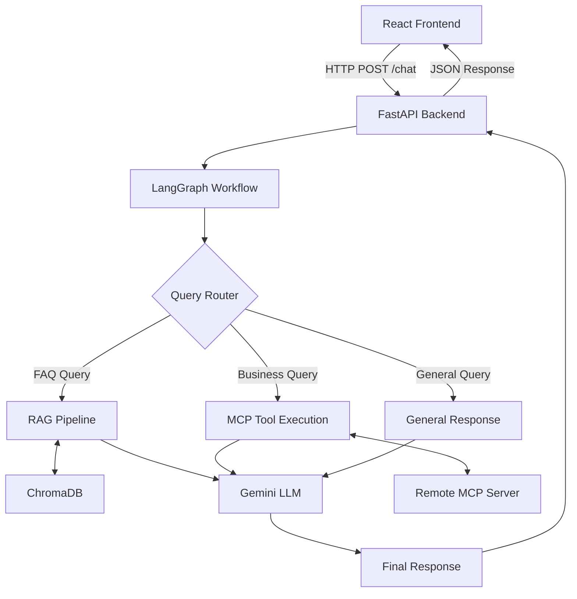
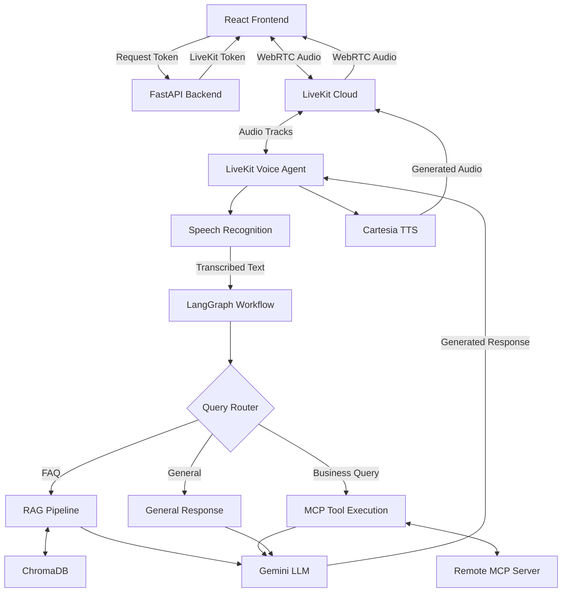

# 🛒 Ecommerce AI Chatbot

An AI-powered ecommerce assistant combining **Retrieval-Augmented Generation (RAG), Model Context Protocol (MCP), and real-time voice interaction** to provide intelligent customer support and execute ecommerce operations.

Built using React, FastAPI, LangGraph, and Gemini, the application goes beyond traditional chatbots by combining knowledge-based question answering with external tool execution and conversational voice capabilities.

## ✨ Key Features

- **RAG-based Question Answering:** Retrieves relevant information from an ecommerce FAQ knowledge base using ChromaDB and Gemini embeddings.
- **MCP Tool Integration:** Connects to a remote MCP server to perform ecommerce operations involving orders and products.
- **Intelligent Query Routing:** Uses LangGraph to route queries to RAG, MCP tools, or general response handling.
- **Parallel Tool Execution:** Executes independent MCP tool calls concurrently for improved efficiency.
- **Real-Time Voice Interaction:** Supports voice conversations through LiveKit and WebRTC.
- **Speech-to-Text:** Uses Gemini for speech recognition.
- **Text-to-Speech:** Uses Cartesia to generate natural-sounding voice responses.
- **Conversation Management:** Maintains conversational context using LangGraph state management and thread IDs.

## 🏗️ System Architecture

The application supports two interaction modes: text-based chat through REST APIs and real-time voice conversations through LiveKit. Both leverage the same LangGraph workflow for query routing and AI-powered processing.

### 1. Text Chat Architecture



### 2. Real-Time Voice Architecture



## 🔄 How It Works

### Text-Based Interaction

1. The user submits a query through the React frontend.
2. FastAPI receives the request and invokes the LangGraph workflow.
3. LangGraph determines the appropriate processing path.
4. The query is handled through one of three paths:
   - **RAG:** Retrieves relevant FAQ documents from ChromaDB.
   - **MCP:** Executes ecommerce operations through tools provided by the remote MCP server.
   - **General:** Handles general conversational queries.
5. Gemini generates the final response using the retrieved information or tool results.
6. FastAPI returns the response to the React frontend.

### Voice-Based Interaction

1. React requests a LiveKit access token from FastAPI.
2. The frontend uses the token to join a LiveKit room.
3. The user's audio is transmitted to the LiveKit Cloud infrastructure through WebRTC.
4. The LiveKit voice agent receives and processes the audio.
5. Gemini converts speech into text.
6. The transcribed query is processed through the LangGraph workflow.
7. The generated response is converted into speech using Cartesia.
8. The audio is streamed back to the user through LiveKit.

## 🛠️ Tech Stack

| Category | Technologies |
|---|---|
| Frontend | React, JavaScript |
| Backend | Python, FastAPI |
| AI Orchestration | LangGraph |
| LLM | Google Gemini |
| Retrieval | RAG, ChromaDB |
| Embeddings | Gemini Embeddings |
| Tool Integration | MCP |
| Voice Infrastructure | LiveKit, WebRTC |
| Speech Recognition | Gemini |
| Speech Generation | Cartesia |
| Version Control | Git |

## 📂 Project Structure

```text
Ecommerce-Chatbot/
│
├── backend/
│   ├── main.py
│   ├── graph.py
│   ├── rag.py
│   ├── voice_agent.py
│   ├── faq_data/
│   └── chroma_db/
│
├── frontend/
│   └── src/
│
├── evals/
│
└── README.md
```

## ⚙️ Getting Started

### Prerequisites

- Python 3.10+
- Node.js and npm
- Google Gemini API key
- LiveKit Cloud account and credentials
- Cartesia API key
- Access to the remote ecommerce MCP server

### 1. Clone the Repository

```bash
git clone YOUR_REPOSITORY_URL
cd Ecommerce-Chatbot
```

### 2. Backend Setup

```bash
cd backend

python -m venv myenv
```

Activate the virtual environment:

**Windows:**
```bash
myenv\Scripts\activate
```

Install the dependencies:

```bash
pip install -r requirements.txt
```

Configure the required API keys, credentials, and service URLs in your environment configuration.

Start the FastAPI backend using the configured application entry point.

### 3. Frontend Setup

Open another terminal:

```bash
cd frontend

npm install
npm run dev
```

Configure the frontend API endpoint and LiveKit connection details for your environment.

### 4. Voice Agent Setup

Configure the LiveKit agent credentials and Cartesia API key.

Start the LiveKit voice agent using its configured development or production command.

**Note:** The backend, frontend, and voice agent must be running for the complete application experience.

## 🎯 Engineering Highlights

This project demonstrates practical AI engineering concepts:

- Combining vector-based retrieval with external tool execution.
- Designing stateful AI workflows using LangGraph.
- Integrating remote MCP servers for structured business operations.
- Executing independent tool calls asynchronously.
- Building real-time voice applications using LiveKit and WebRTC.
- Integrating speech recognition and speech synthesis.
- Connecting frontend, backend, AI orchestration, and external services into a unified application.

## 👨‍💻 Authors

**Your Name**
- GitHub: [@your-github](https://github.com/PrathmeshDhapate)
- LinkedIn: [Your LinkedIn](https://www.linkedin.com/in/prathmesh-dhapate-2455432b4/)

**Teammate's Name**
- GitHub: [@teammate-github](https://github.com/MeetGudhka)
- LinkedIn: [Teammate's LinkedIn](https://www.linkedin.com/in/meetgudhka02102005/)
